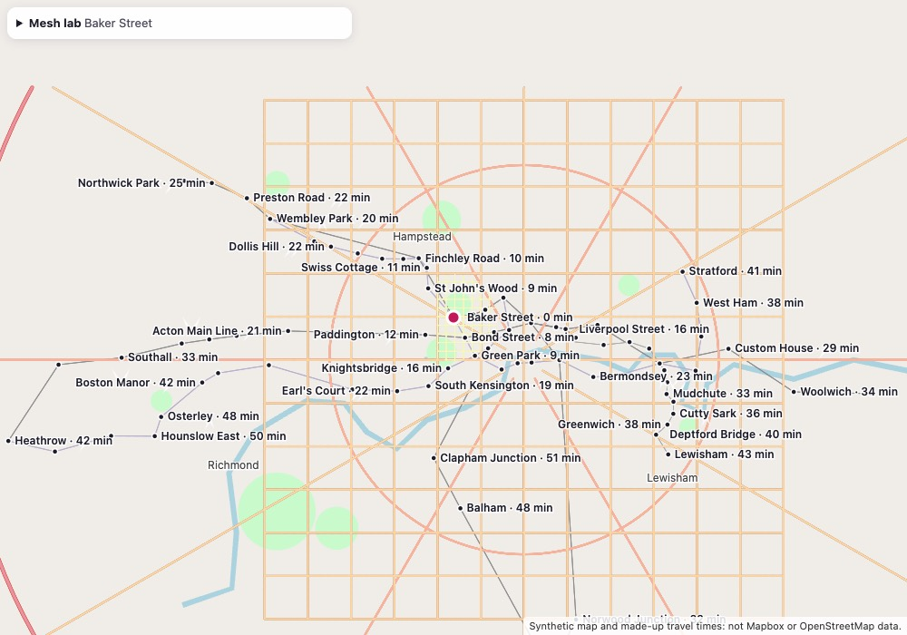
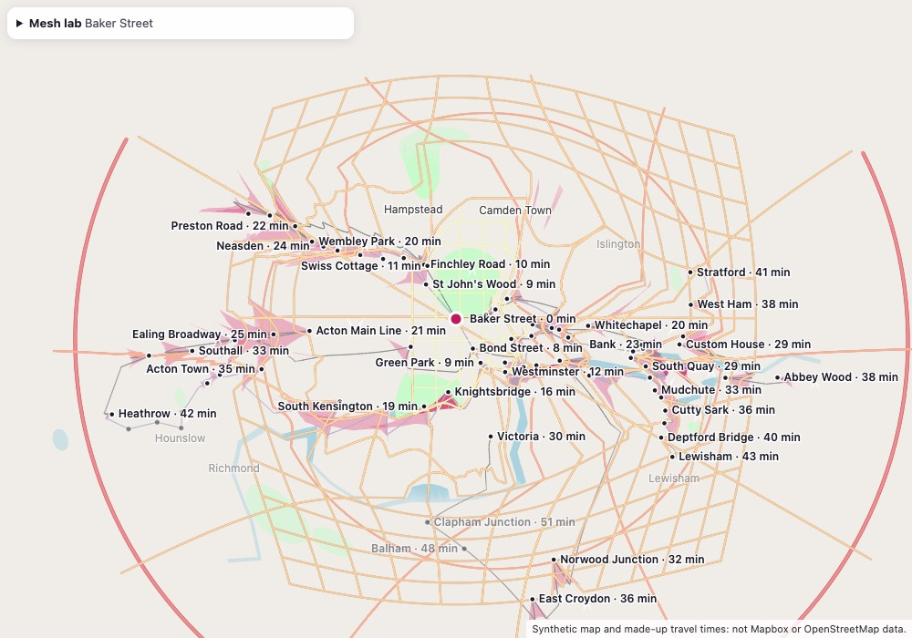
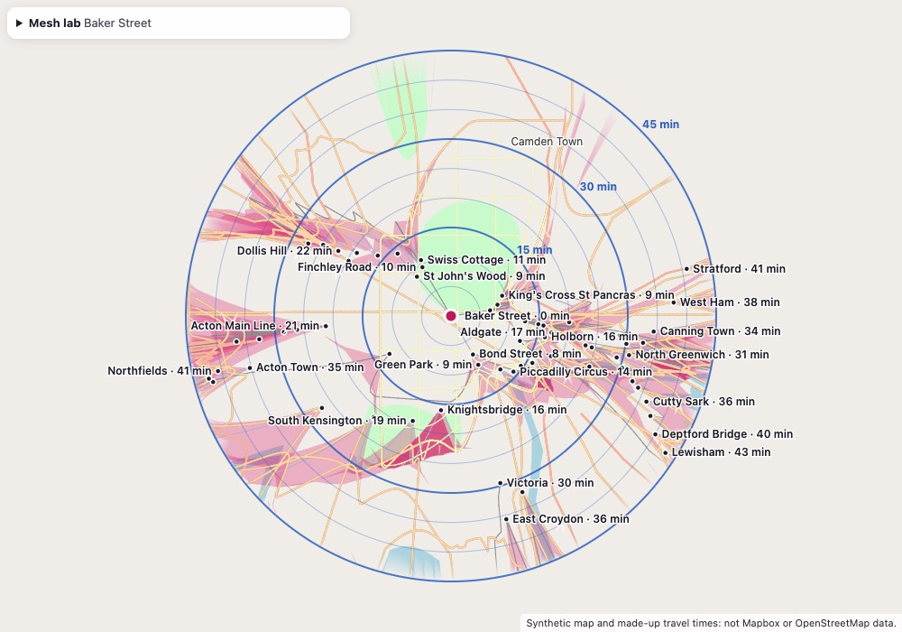
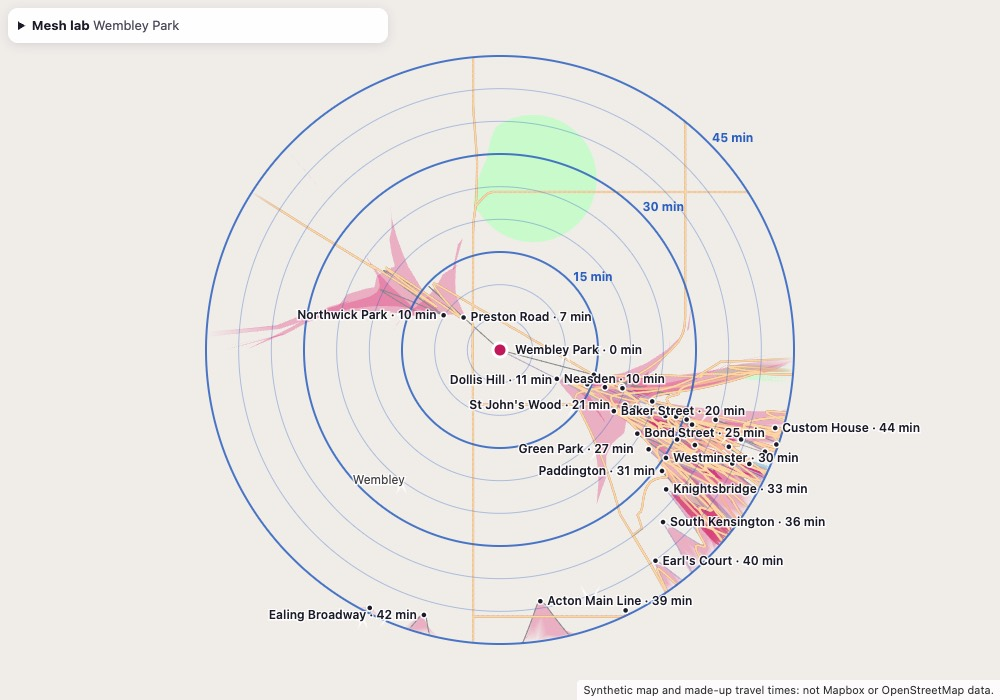

# Warp renderer spike: the GPU mesh the London map reuses

Issue #5, part W-01 (Direction 5). Written 2026-11-13 against `master` at 002af68.

**Status.** The renderer, the lab and the checks are built.

- **Desktop results** (Apple M2, headless Chrome 157): back-ends B and C pass every gate the lab
  can measure, except G4 on one field at one origin (the cliff field at Wembley Park, see
  [Chord error per field](#chord-error-per-field-and-origin)).
- **The deck.gl probe (A)** fails the line-width gate.
- **Not yet measured:**
  - the two phones;
  - real map tiles (the census needs a tiles token, which this worktree didn't have).

  So the decision below is provisional. The steps for each are in [What is left](#what-is-left).

All travel times here are **synthetic** (`static/warp/lab/stations.json`, made-up speeds over
hand-typed station positions). So is the lab's default geometry. They test the renderer; they
say nothing about transit in London.

## What was built

| Path | What it is |
|------|-----------|
| `static/shared/mesh/frame.js` | Coordinate frames: Web Mercator, local metres around an origin, MapLibre's 512-px camera (with its origin) |
| `static/shared/mesh/field.js` | A travel-time field (minutes on a 100 m grid, −1 = no data) and a grid of target positions (`GRID_NO_DATA` for holes) |
| `static/shared/mesh/warp.js` | The warp: `toScreen(lon, lat, cam, u)`, `placement()`, `jacobian()`, `screenJacobian()`, and `WARP_GLSL`, its shader twin |
| `static/shared/mesh/cover.js` | Which tiles to load: a quadtree, finer near the origin, over what the field reaches |
| `static/shared/mesh/tessellate.js` | Clip to the tile, split lines, cut fills into grid cells and earcut them; the budget |
| `static/shared/mesh/schema-streets-v8.js` | Everything about the tile schema: layers, classes (slip roads included), colours, widths, labels |
| `static/shared/mesh/pipeline.js` | decode → classify → tessellate a tile; pack tiles into one buffer per pass, stamped with their origin |
| `static/shared/mesh/worker.js` | Module worker: fetches `/tiles` (shared across scenes), caches tessellated tiles, packs scenes |
| `static/shared/mesh/caps.js`, `renderer.js` | The WebGL2 renderer, its capability probe and its transform-feedback evaluator |
| `static/shared/mesh/labels.js` | Label placement and the tap index |
| `static/shared/vendor/` | pbf 5.1.2, @mapbox/vector-tile 3.0.0, @mapbox/point-geometry 1.1.0, earcut 3.2.4 |
| `static/warp/lab/` | The lab page (`/warp/lab/`): fields, synthetic geometry, self-test, benchmark, census, deck.gl probe |
| `scripts/lab_headless.mjs` | Drives the lab in a headless Chrome; every desktop number here came from it |
| `docs/warp-renderer-spike-results.json` | The raw self-test and benchmark output behind the tables below |

`/warp/`, `warpmath.js` and `server/` are unchanged. The lab is not linked from anywhere, is
`noindex`, and is not in the service worker's app shell.

### How it draws

```
screen(p) = mix(ordinary(p), pin + k · target(p), u)        p = local metres
```

**The terms:**

- `ordinary(p)` is MapLibre's projection, so at u = 0 the mesh lines up with the normal map.
- `target(p)` is the layout:
  - **polar** keeps the bearing from the origin and sets the distance to the field's minutes
    (exact at every vertex);
  - **grid** interpolates a grid of target positions (any layout, e.g. #6's).

**Places with no target.** Where the field has no data, or a place is past the outer minute, it
fades out as u → 1. It still moves:

- polar: onto the outer ring along its own bearing;
- grid: it stays where it is.

So a triangle or segment with one known and one unknown corner stays short and inside the
ring; it never streaks out to the unbent map. Lines fade per end, along the segment. What to
show past the outer ring is still #5's open question; this is the default.

**Origins.** A scene is packed in metres around one origin and says so (`scene.origin`).
`draw()` refuses a camera or warp from another origin. The lab switches origin, warp, texture
and scene together, when the new scene arrives, and keeps the old view on screen until then.

**Three back-ends** share the worker, the buffers and the draw calls:

- **B (gpu):** the vertex shader evaluates `target()` from an R32F (polar) or RG32F (grid)
  texture, with `texelFetch` and hand-written bilinear interpolation.
- **C (cpu):** the worker evaluates `target()` for every vertex and the shader only mixes by u.
  It needs no textures.
- **A (deck.gl probe):** deck.gl 9.4.1's `LineLayer` and `SolidPolygonLayer` draw the same
  buffers. A `LayerExtension` moves each vertex in `vs:DECKGL_FILTER_GL_POSITION` and fades in
  `vs:DECKGL_FILTER_COLOR`.

**Geometry:**

- **Lines** are one instanced quad per segment. They are extruded in screen pixels after both
  ends are mapped, and drawn as a capsule with analytic anti-aliasing.
- **Fills** are cut into grid cells and drawn with no face culling, so folded (flipped)
  triangles still show.
- **One ground cell at every zoom.** The cell is about 48 m: 128 cells per z12 tile edge, 32 per
  z14, 512 per z10. So tiles of different zooms put the same vertices on their shared edge, and
  the warp can't open a crack there. The tile zoom only sets how generalised the source
  geometry is.
- **Tile meshes** are cached per tile and don't depend on the origin. A new origin repacks
  cached tiles into local metres; float32 is millimetre-exact at 25 km.
- **"Tint folds"** (lab) draws a layer built from the field's own cells, only where it flips,
  under the lines. So every fold shows, not only folded parks and water.

### The contract for the London map (#6)

```js
import { createTargetGrid, GRID_NO_DATA } from "/shared/mesh/field.js";
import { createWarp } from "/shared/mesh/warp.js";
import { makeCamera } from "/shared/mesh/frame.js";
import { createMeshRenderer } from "/shared/mesh/renderer.js";

// 1. Rasterise the layout into a grid of target positions (local metres around `origin`);
//    a node with no target gets x = GRID_NO_DATA.
const grid = createTargetGrid({ origin, cell: 500, nx, ny, x0, y0, xy /* Float32Array, 2 per node */ });
const warp = createWarp({ kind: "grid", grid });
// 2. Per vertex, the same function the shader runs (labels, hit tests, checks):
const { x, y, alpha } = warp.toScreen(lon, lat, camera, u);   // CSS px
// 3. Draw: renderer.setWarp({kind: "grid", grid}); renderer.setScene(scene); renderer.draw(camera, u)
//    (scene from packScene around the same origin, or draw() returns {skipped}).
```

- **Camera.** `camera` comes from `makeCamera(warp.frame, {centerLon, centerLat, zoom, width,
  height, k})`, or `cameraFromMap(map, warp.frame, k)`, and carries its origin.
- **`k`.** For a grid it is the camera's own `ppm`, so layout units are metres.
- **Folds and stretch.** `warp.screenJacobian(x, y, camera, u)` gives fold and stretch for the
  map as it is on screen now.
- **Shader side.** `WARP_GLSL` with `#define WARP_GRID`, or `CPU_TARGETS` for back-end C.
- **No copies.** The renderer keeps no CPU copy of a scene (the lab keeps one, for its checks).

## Gates, fixed before measuring

| Gate | What | Pass |
|------|------|------|
| G1 parity | GPU positions (transform feedback) vs `warp.js`, 1,000 vertices × 2 views × u ∈ {0, ½, 1}; for C, with the worker's own placements | ≤ 0.1 px |
| G2 registration | u = 0 vs `map.project`, at three zooms | ≤ 0.5 px |
| G3 radius | random field points drawn as dots through the line program, centres read back from pixels: \|centre − pin\| vs k·T at u = 1, and the ordinary position at u = 0 | ≤ 1 px; ≤ 0.5 px |
| G4 chord | points on drawn segments and triangles vs the exact warp, sampled by size on screen, away from folds; near folds, near no data, and primitives crossing the outer minute reported on their own | ≥ 99% within 1 px |
| G5 width | widths read back from pixels: a chain of 4 px segments with a 30° kink, single segments at 12 angles, and one segment where the map stretches ≥ 4:1 | each ±0.25 px |
| G6 frames | morph and pan, judged on the phones; desktop records draw() CPU time and GPU time beside the vsync-capped frame interval | phones: p50 ≤ 17 ms, p95 ≤ 33 ms |
| G7 origin change | warm tiles, field ready, bent map → first frame of the new origin with the GPU finished (includes B's texture upload) | p95 ≤ 200 ms (slower phone) |
| G8 new origin | cold tiles → first frame, real tiles only (`?geom=tiles`); a missing tile fails it | p95 ≤ 1.5 s |
| G9 budget | vertices shaded (fill vertices + 6 per line segment) and tiles per origin | ≤ 300k and ≤ 48, or `overBudget` reported |
| G10 capabilities | each `?caps=` rung draws, no extension required | no console errors |

The reference views for G1, G3 and G4 are 390×844 and 1440×900, with the 45-minute ring at
0.42 of the short side.

**Decision rule (D22):**

- A back-end passes if it meets G1–G8 on both phones.
- Among those that pass, prefer the one with the fewest capability needs (C, then B, then A),
  unless another is at least 2× faster on origin change.
- If none passes, transit uses the geographic reach view.

## Results: desktop

**Setup.**

- Machine: Apple M2, macOS, headless Chrome 157 (ANGLE Metal), DPR 1.
- Geometry: synthetic (the toy rail lines, ring and radial roads, a Thames band, a lake with an
  island, parks).
- Cells: 48 m.
- Origins: Baker Street, Wembley Park, Canary Wharf, Heathrow, Croydon (East Croydon).

**How to read the frame numbers.** Headless Chrome caps animation frames at 60 Hz, so the frame
interval only shows that no frame was missed. The draw-call and GPU times are the useful desktop
numbers.

| Gate | B (gpu) | C (cpu) | A (deck.gl) |
|------|---------|---------|-------------|
| G1 parity | **pass**: max 0.0033 px, 6,000 samples, alphas equal | **pass**: max 0.0001 px, 6,000 samples, alphas equal | not measurable (no evaluator) |
| G2 registration | **pass**: max 0 px | **pass**: max 0 px | **pass**: max 0 px |
| G3 radius (drawn) | **pass**: radius max 0.058 px, ordinary max 0.061 px (300/300 dots) | **pass**: radius max 0.058 px, ordinary max 0.061 px (300/300 dots) | not measured (no pixel read-back) |
| G4 chord, phone view | 99.94% within 1 px, p99 0.192 px | 99.94% within 1 px, p99 0.192 px | 100.00% within 1 px, p99 0.258 px |
| G4 chord, desktop view | 99.84% within 1 px, p99 0.379 px | 99.84% within 1 px, p99 0.379 px | 99.53% within 1 px, p99 0.555 px |
| G4, reported apart | near folds 98.5% (p99 1.908 px); crossing the outer minute: 522 primitives, longest edge at u = ½ 20.1 px | same mesh | same mesh |
| G5 width (px) | **pass**: chain 1.635, kink 1.62, 12 angles 1.46–1.501 (nominal 1.5); stretched 2670:1 → 1.818 vs 1.815 | **pass**: chain 1.635, kink 1.62, 12 angles 1.46–1.501 (nominal 1.5); stretched 2670:1 → 1.818 vs 1.815 | **fail**: 25% of segments under 75% of their width, 6.9% under 25% (computed) |
| G6 frames (5 origins) | frame p50/p95 16.7/16.8 ms; draw() p95 0.2 ms; GPU ≤ 5.84 ms a frame | frame p50/p95 16.7/16.8 ms; draw() p95 0.2 ms; GPU ≤ 4.99 ms a frame | frame p50/p95 16.7/16.8 ms; draw() p95 4.2 ms (it rebuilds its layers every frame); no GPU timer |
| G7 origin change | **pass**: p50 11.5, p95 16.6 ms | **pass**: p50 11.2, p95 19.9 ms | **pass**: p50 15.9, p95 26.8 ms |
| G8 new origin | not measured (no network); p95 38 ms without it | not measured (no network); p95 39.8 ms without it | not measured (no network); p95 49.5 ms without it |
| G9 budget (transit) | **pass**: ≤ 204,859 shaded, ≤ 41 tiles | **pass**: ≤ 204,859 shaded, ≤ 41 tiles | **pass**: ≤ 204,859 shaded, ≤ 41 tiles |

- **G10 rungs:**
  - `?caps=no-vtf` and `?caps=no-r32f` fall back to C.
  - `?caps=no-webgl2` shows the ordinary MapLibre map.
  - Losing and restoring the WebGL context shows the ordinary map, then the mesh again.
- **Probe A's size:** deck.gl adds 577 kB gzipped (`dist.min.js` 9.4.1). Our renderer is 29 kB
  gzipped, plus 21 kB of vendored decoders.

### Stress run

**Setup.** 24 m cells, about 300k shaded at Baker Street. A 390×844 view at DPR 2, with the CPU
throttled 4× by Chrome. The worker's own times don't change under that throttle, so it slows only
the main thread. This run is indicative, not a phone.

| | B (gpu) | C (cpu) |
|---|---|---|
| Shaded per origin | 294,562–299,652 | 294,562–299,652 |
| Frames, worst p50 / p95 | 16.7 / 16.8 ms (worst frame 33.3 ms) | 16.7 / 16.8 ms (worst frame 33.3 ms) |
| draw() CPU p95 | 0.7 ms | 0.4 ms |
| GPU time a frame | 3.85–6.57 ms | 2.86–5.42 ms |
| G7 origin change, p95 | 15.7 ms | 32 ms |
| Worker pack at Baker Street | 12 ms | 16.9 ms |

### Spacing sweep

Baker Street, transit field, phone view, G4's measure (sampled by size on screen).

| Cells | Shaded | Within 1 px | p99 | Near folds within 1 px |
|---|---:|---:|---:|---:|
| 95 m | 96,763 | 99.15% | 0.939 px | 96.3% |
| 48 m | 204,859 | 99.85% | 0.252 px | 98.0% |
| 24 m | 297,438 | 100.00% | 0.093 px | 99.4% |

95 m cells fail the size-weighted check, so the default is 48 m.

### Chord error per field and origin

G4's measure, phone view, away from folds.

| Field | Baker Street | Wembley Park | Canary Wharf | Heathrow | Croydon |
|---|---|---|---|---|---|
| transit | 99.84%, p99 0.333 px | 100.00%, p99 0.227 px | 99.82%, p99 0.304 px | 100.00%, p99 0.074 px | 99.89%, p99 0.159 px |
| walk | 100.00%, p99 0.081 px | 100.00%, p99 0.035 px | 100.00%, p99 0.063 px | 100.00%, p99 0.036 px | 100.00%, p99 0.036 px |
| cliff | 99.91%, p99 0.097 px | 94.19% **fail**, p99 2.199 px | 99.85%, p99 0.059 px | 99.84%, p99 0.233 px | 100.00%, p99 0.049 px |

The cliff field at Wembley Park fails. The river is a 9-minute jump within one field cell, so a
fixed 48 m mesh can't follow it there. The plan named this risk. Its fallback is a mesh
refined per origin where the field jumps (warp-aware re-tessellation in the worker). That
belongs with the real field (W-02), because only #1's field shows where real jumps are.

### Folds and stretch on the synthetic fields

These are renderer diagnostics, not Direction 4's verdict, because the fields are made up.

- **Folded share:** the part of the 45-minute ring covered by folded sheets, counted once where
  sheets stack (a rasterised union).
- **Stacked:** the same with overlaps counted every time.
- **Stretch:** the median over field cells inside the ring, folded ones included, of the largest
  local scale over the smallest.

| Field | Baker Street | Wembley Park | Canary Wharf | Heathrow | Croydon |
|---|---|---|---|---|---|
| transit | 19.7% (stacked 28.1%), 5.8:1 | 8.5% (stacked 12.7%), 5.8:1 | 19.2% (stacked 24.9%), 5.6:1 | 12.8% (stacked 17.5%), 4.8:1 | 9.3% (stacked 12.7%), 6.7:1 |
| walk | 0.0% (stacked 0.0%), 1.0:1 | 0.0% (stacked 0.0%), 1.0:1 | 0.0% (stacked 0.0%), 1.0:1 | 0.0% (stacked 0.0%), 1.0:1 | 0.0% (stacked 0.0%), 1.0:1 |
| cliff | 0.0% (stacked 0.0%), 1.0:1 | 0.0% (stacked 0.0%), 1.0:1 | 0.0% (stacked 0.0%), 1.0:1 | 0.0% (stacked 0.0%), 1.0:1 | 0.0% (stacked 0.0%), 1.0:1 |

Walk and cliff fields don't fold, and their stretch is 1.0:1. The toy network misses both
proposed Direction 4 limits (10% folded, 3:1 stretch) at most origins. That is a warning, not a
result: W-02 must run the same numbers on #1's real field.

### Screenshots

Back-end B, synthetic geometry, toy transit field, 1000×700 at DPR 1, taken with
`scripts/lab_headless.mjs` (`--size 1000x700`). URL `/warp/lab/?backend=b&field=transit&origin=…&folds=…`.

| Baker Street, ordinary (u = 0, folds off) | Halfway (u = 0.5, fold layer on) |
|---|---|
|  |  |
| **Baker Street, bent (u = 1, fold layer on)** | **Wembley Park, bent (u = 1, fold layer on)** |
|  |  |

**What the screenshots show:**

- **Halfway:** places past 45 minutes move towards the outer ring and fade. The rings appear
  only at the end of the morph.
- **Bent:** nothing is drawn outside the 45-minute ring.
- **Baker Street, bent:** Wembley Park's dot is at 20 minutes west-north-west. Its label loses a
  collision with Finchley Road's (10 min); a tap lists it.
- **Wembley Park, bent:** Baker Street sits at 20 minutes in the narrow, folded wedge that the
  Metropolitan and Jubilee lines pull central London into.
- **Every station** has a dot, with its label beside it. Over synthetic geometry the corner says
  so instead of showing Mapbox's credit.

## Decision (provisional)

On desktop, B and C pass every gate the lab measures. The exception is G4 on the cliff field at
Wembley Park, which is a question about the mesh and applies to both.

A fails G5: its adapter only translates the corners that deck already extruded, so lines go thin
where the bend turns them (25% of segments under 75% of their width). A hook
that rebuilt the extrusion from extra attributes, or a `LineLayer` subclass with its own vertex
shader, could keep the width. That was not built, because it means writing our line shader again
inside deck, on top of 577 kB.

**Under D22 as written, C is preferred on the desktop numbers.** B is not 2× faster on origin
change (G7 p95: B 16.6 ms, C 19.9 ms). B stays in the code as a `#define`.

On the throttled stress run (24 m cells, about 300k shaded), B is 2.0× faster: 15.7 ms against 32
ms. That sits exactly at D22's threshold, so the phone runs decide.

**One decision for the owner.** D22 ranks C first for needing "no vertex float textures". Those
are core WebGL2: every conformant device has them, and the probe confirms it at start-up. C's own
costs:

- 24 bytes more per fill vertex and per segment;
- a full repack and re-upload of the scene whenever the field changes (another mode or
  departure time), where B uploads one texture;
- a per-origin target pass in the worker (about 5 ms for 297,438 shaded vertices on the M2).

My recommendation is to rank B first, with C as its fallback. The rule was approved as written,
so this is the owner's call.

**Either way the decision waits on two runs:**

- the phones, for G6–G8;
- the census, because real tiles may hold far more vertices than the synthetic scenes.

## Label policy (as built)

- **Drawn on the 2D overlay** in the system font, upright. The mesh makes no glyph requests.
- **Candidates come from our own decoded tiles,** never `queryRenderedFeatures`, which misses
  places that start off screen.
- **Placed every drawn frame,** for the map as it is on screen now (current camera and u). So
  labels never collide mid-morph, and a tap queries the positions being drawn.
- **Priority:**
  1. stations: within a rank, the one reached sooner first;
  2. places by `symbolrank`.

  There are no road names in the mesh view.
- **Stations** get a dot, labelled or not, and their label goes beside the dot: right, else
  left, then further out.
- **Places** are centred on their point.
- **Every box** must fit inside the view and clear the pin and the labels already placed, with a
  4 px gap. At most 40 labels on a phone, 80 on desktop.
- **Hiding:** a place is hidden where the map on screen is folded (det ≤ 0) or stretched beyond
  3:1. Stations are never hidden for that: a fast line folds the map right at its stations, so
  hiding them would hide what transit is about.
- **Tap index:** every candidate, placed or not, goes into a 24 px screen grid. A tap lists all of
  them within 12 px, with minutes. The lab shows the list; the overlap UI is W-02's.

## Float textures (#3)

- **B** uses R32F/RG32F textures with NEAREST filtering, read by `texelFetch` with hand-written
  bilinear interpolation. That is core WebGL2: no extension is asked for.
  - The probe (`caps.js`) uploads a 2×2 texture, runs the real warp code over it through
    transform feedback, and checks the result.
  - The renderer then compiles every program it can need. If that fails it drops a rung (gpu →
    cpu → unsupported); the self-test records `fellBack` and `programsError`.
  - `OES_texture_float_linear` and `EXT_color_buffer_float` are listed but never used.
  - A static test forbids `getExtension` in `static/shared/mesh/`.
- **C** uses no textures at all, so a phone without float vertex textures still gets the bent map.
- **No WebGL2, or a lost context:** the lab shows the ordinary MapLibre map, which is the
  geographic view.

## Tiles and budget

**The cover** spans what the field reaches within the outer minute, plus 1 km for the fade-out:

- walking needs 10–24 tiles per origin;
- the toy transit field needs 20–41.

**Rings:** z14 within 1 km, z12 within 10 km, z10 beyond.

- A tile is split into four, so the cover also holds z11 and z13 tiles.
- Over 48 tiles, every ring shrinks by 20% at a time, up to 8 rounds, before any far tile is cut.
- The plan's first guess (z14 within 2 km, over ±25 km) wanted 51–78 tiles.

**Cost.** At the default 6,428 tiles a day (`TILES` monthly cap ÷ 28) that is about 150–640 new
origins a day, before the browser's one-hour cache. MapLibre's own tiles for the ordinary view
come on top in the product. The lab's MapLibre style is background-only unless "Show base map"
is on.

**Fetching:**

- A tile is fetched once however many scenes want it. A newer scene aborts only the fetches it
  doesn't need.
- 429 and 503 are retried once, and only when Retry-After is ≤ 2 s. Each retry costs the
  visitor's per-IP quota, and a spent budget answers 503.
- The server's 16-request tile limit is per process, shared by every visitor. The worker keeps 8
  in flight, so two cold loads at once fill it.

**Vertex budget:** 300k vertices shaded per scene, 600k cached in the worker. The cache limit is
enforced after every scene, including the current tiles once packed.

- **Over budget, the worker drops**, farthest first within each class:
  1. secondary roads;
  2. the smallest parks;
  3. the smallest water;
  4. minor rail;
  5. primary roads.
- It never drops motorway, trunk or major rail, and reports `overBudget` instead.
- Fully covered blocks share their grid nodes.
- **Synthetic scenes:** 8k–205k shaded at 48 m. Whether real tiles fit is the census's question.

## Changes from the plan

- **Coordinates (D9).** The plan had tile-local vertices plus a uniform array of tile origins.
  Built instead: cached tile meshes are repacked into local metres for each origin, and every
  scene carries its origin.
- **Tessellation (D11).** One ground cell at every zoom (48 m), not tile size / 64 per tile.
  - Per-tile spacing left non-matching vertices where zooms meet, and was coarsest (381 m) in
    the far field.
  - 95 m cells fail the size-weighted chord check.
- **Tile cover (D10).** Rings at z14 within 1 km, not 2 km. They shrink over the cap, and the
  cover spans the reachable area, not ±25 km.
- **No data and past the outer minute (D16).** Polar places move onto the outer ring while they
  fade, instead of staying put. Grid places stay put.
- **Labels (D17).**
  - Stations are not hidden on folds.
  - Placement runs every frame, judged on the map as it is on screen now.
  - Station dots, the pin as an obstacle, and whole boxes inside the view.
- **Budget (D19).**
  - Counted in vertices shaded, not "fill vertices plus segment instances".
  - The shed order adds secondary roads first.
  - Water is dropped smallest first rather than simplified.
  - Farthest first within a class.
- **Secondary roads.** Kept within 2 km of the origin by distance, not by tile zoom.
- **deck.gl probe (D4).** `LineLayer` instead of `PathLayer`, because it takes our per-segment
  buffers directly. Naming LineLayer's own attributes in the hook stopped the shader compiling,
  so the hook reads the segment end from `geometry.uv`.
- **Lab geometry.** Synthetic by default. `?geom=tiles` uses real tiles and is required for the
  census.

## What is left

1. **Tile census (owner, needs a tiles token).**
   - Run `uvicorn server.app:app`, open `/warp/lab/?geom=tiles&census=1`, then press "Copy
     results".
   - It records:
     - per-layer counts;
     - the `road.class × structure` histogram (are the Underground's tunnels in Streets v8? are
       the `*_link` classes there?);
     - the `transit_stop_label` keys, and whether `road_label` exists;
     - per origin: bytes, decode time, and vertices shaded at 95, 48 and 24 m cells.
   - Then fix the rings, the cell size and the class filters here. Run the benchmark again with
     `?geom=tiles`: that is the only run that measures G8.
2. **Phones (owner).**
   - On the iPhone (Safari) and the mid-range Android (Chrome), open `/warp/lab/?backend=b`,
     then `?backend=c`.
   - Each time press "Self-test", then "Run benchmark" (a few minutes; don't touch the screen),
     then "Copy results", and paste the JSON here.
   - Results accumulate in the page's storage until "Clear results". Record the exact models and
     browser versions.
3. **The D22 tie-break:** the owner's call (see Decision).
4. **W-02** takes over:
   - the real field (#1's composition and the walking near field), including where it jumps
     (the cliff case above);
   - the two views;
   - Direction 4's checks on real fields;
   - the overlap UI on top of the tap index;
   - what to show past the outer ring;
   - fold ordering (folded sheets overlap in draw order today);
   - the content gap at u = 0: the mesh has no buildings, minor streets or road names, while
     the ordinary map does, so a morph from the full MapLibre map would pop;
   - retiring the radial lookup table.

## Risks and things not checked

- **Mapbox terms.** Mapbox's terms for drawing Streets tiles with our own renderer weren't read
  (see `docs/provider-terms.md`). The spike stores no Mapbox tiles: the test tile is encoded by
  hand, and the lab's default geometry is made up. Confirm the terms before shipping.
- **Rail in Streets v8 is unverified:**
  - `major_rail` and `minor_rail` on `road`, with `structure=tunnel`;
  - whether rail survives at z10;
  - whether the Underground is present at all.

  If it isn't there, rail geometry has to come from #1's GTFS shapes through the same adapter.
- **Real tiles may still join badly where zooms meet,** because they are generalised
  differently. The mesh can't crack there any more, but the geometry itself may not match. The
  synthetic geometry is the same at every zoom, so it can't show this.
- **Fading lines double-blend at their joints.**
  - Opaque lines measure 1.635 px on a 4 px-segment chain against 1.5 nominal (+0.13 px; within
    G5).
  - Lines fading out (crossing the outer minute, during the morph) blend twice where segments
    overlap. That shows as faint beads on those lines while they fade.
  - Fixing it needs joins built from each segment's neighbours. That means two more warp
    evaluations per vertex, so it waits for the phone numbers.
- **Holes inside the reachable area** (#1's unreachable cells, if they come as "no data") would
  move onto the outer ring while fading, and make faint radial slivers mid-morph. W-02 should
  give unreachable places a time past the outer minute, or decide how holes look.
- **One worker** decodes and tessellates every tile. Synthetic scenes take 1–30 ms in the worker;
  real tiles are unmeasured. If the census shows a phone missing G8, add a small worker pool.
- **Desktop numbers say little about phones,** and headless Chrome caps frames at 60 Hz.
- **The lab spends tile budget only with `?geom=tiles`.** It is unlinked and `noindex`; the
  per-IP and monthly caps still apply.
